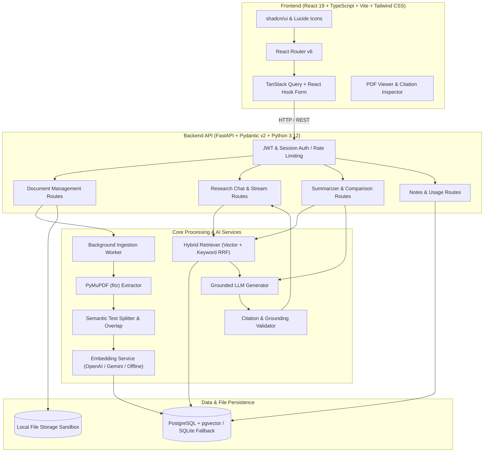

# ResearchPilot AI — Intelligent Research Assistant


**ResearchPilot AI** is a production-minded full-stack research assistant that enables researchers, academics, software engineers, and technical professionals to upload research papers (PDFs), ask complex natural-language questions, receive evidence-grounded answers with verifiable page-level source citations, generate structured paper summaries, and perform multi-document comparisons.

Built with a strict **Retrieval-Augmented Generation (RAG)** pipeline, the system grounds answers exclusively in retrieved document passages and explicitly communicates uncertainty when sufficient evidence is unavailable rather than fabricating facts.

---

## Architecture Overview



---

## Key Features

1. **Verifiable Page-Level Citations**: Answers cite exact page coordinates and excerpts. Clicking a citation opens the document reader directly at the referenced page.
2. **Honest Uncertainty Protocol**: When context passages lack sufficient evidence, the model communicates this explicitly instead of inventing facts.
3. **Hybrid Retrieval with Reciprocal Rank Fusion (RRF)**: Combines dense vector similarity with lexical keyword search, ensuring technical terms, mathematical notations, and conceptual queries are retrieved accurately.
4. **Structured Scientific Summarizer**: Breaks down research papers into Title, Problem, Abstract, Objectives, Methodology, Datasets, Algorithms, Results & Metrics, Limitations, and Future Work.
5. **Multi-Paper Comparison Workspace**: Synthesizes 2 to 4 research papers into side-by-side comparative matrices highlighting trade-offs and baseline conditions.
6. **Integrated PDF Reader**: Embedded document viewer with page navigation, zoom, and extracted chunk fallback.
7. **Research Notebook**: Save useful AI answers as structured notes, tag findings, link to papers, and export notes as Markdown.
8. **Multi-Tenant Security**: User data, chunks, conversations, and files are strictly isolated by owner ID. Uploaded files are sandboxed with path traversal protection.
9. **Automated AI Evaluation Benchmark**: CLI test suite measuring Retrieval Recall@K, MRR, Faithfulness, Citation Validity, and Uncertainty Handling.
10. **ResearchPilot Studio (AI Podcast Studio)**: Convert single or multiple scientific papers and educational YouTube lectures into natural, engaging multi-speaker audio podcasts, structured summaries, and high-yield smart notes with an integrated audio player (0.75x–2x speed controls, seeking, MP3 download).

---

## ResearchPilot Studio (AI Podcast Studio)

ResearchPilot Studio bridges complex academic publications and auditory learning:

- **Documents to Podcast**: Select single research papers or synthesize multiple papers concurrently. Preserves page-level citations across all selected sources.
- **YouTube to Podcast**: Validate and extract authorized transcripts and metadata from educational YouTube lectures (with timestamps and manual transcript fallback).
- **Five Presentation Styles**:
  1. *Two-Host Discussion*: Alex (Host 1) and Taylor (Host 2) converse dynamically, ask clarifying questions, and unpack nuances.
  2. *Single-Host Lecture*: Authoritative monologue by an expert academic narrator.
  3. *Exam Preparation*: High-yield definitions, formulas, revision points, and testable concepts.
  4. *Beginner-Friendly Explanation*: Plain-language intuitive metaphors without scientific distortion.
  5. *Research Critical Deep-Dive*: Evaluates methodology, baselines, error metrics, and stated limitations.
- **Multi-Voice Neural TTS**: Free, zero-config neural voices (Microsoft Edge Neural TTS: Alex `GuyNeural`, Taylor `JennyNeural`, Narrator `ChristopherNeural`) or optional OpenAI TTS (`tts-1`).
- **Interactive Player**: Real-time seeking, speed controls (0.75x, 1x, 1.25x, 1.5x, 2x), and direct MP3 download.
- **Smart Study Notes & Self-Testing**: Key concepts, definitions, formulas, and interactive self-test cards with one-click export into your Saved Notes workspace.

---

## Tech Stack

| Layer | Technologies |
| :--- | :--- |
| **Frontend** | React 19, TypeScript, Vite, Tailwind CSS v4, Lucide React, TanStack Query, Recharts |
| **Backend** | Python 3.12, FastAPI, Pydantic v2, SQLAlchemy 2.0, Alembic, Uvicorn |
| **Database & Vector** | PostgreSQL 16 with pgvector (Docker/Production), SQLite with vector math (Local Dev) |
| **Document Processing** | PyMuPDF (fitz), custom recursive semantic text splitter with overlap |
| **AI & Embeddings** | OpenAI (`gpt-4o-mini`, `text-embedding-3-small`), Google Gemini (`gemini-1.5-flash`), or zero-cost offline deterministic engine |
| **Testing & Quality** | pytest, pytest-asyncio, HTTPX, GitHub Actions CI |

---

## Quick Start (Local Development)

### Prerequisites
- Python 3.12+
- Node.js 20+ and npm

### 1. Clone & Configure Environment
```bash
# Copy environment configuration template
cp .env.example .env
```

### 2. Backend Setup
```bash
cd backend

# Install dependencies
pip install -r requirements.txt

# Run database migrations
python -m alembic upgrade head

# Start backend server
uvicorn app.main:app --host 127.0.0.1 --port 8000 --reload
```
API Documentation will be accessible at: `http://localhost:8000/api/docs`

### 3. Frontend Setup
In a new terminal:
```bash
cd frontend

# Install dependencies
npm install

# Start Vite development server
npm run dev
```
Open your browser at `http://localhost:5173`.

---

## Running with Docker Compose

To run the complete stack with PostgreSQL and `pgvector`:

```bash
docker compose up --build -d
```

- **Frontend Application**: `http://localhost:5173` or `http://localhost`
- **Backend API**: `http://localhost:8000`
- **Interactive OpenAPI Docs**: `http://localhost:8000/api/docs`
- **PostgreSQL with pgvector**: `localhost:5432`

---

## Running Automated Tests & AI Evaluation

### 1. Run Backend Unit & Integration Tests (pytest)
```bash
cd backend
python -m pytest app/tests -v
```
Tests cover registration, authentication, PDF upload validation, PyMuPDF extraction, chunking, hybrid retrieval, grounded citations, uncertainty handling, and cross-user tenant isolation.

### 2. Run AI RAG Quality Benchmark
```bash
python evaluation/scripts/evaluate_rag.py
```
Outputs a detailed report measuring:
- **Retrieval Recall@K (K=4)**: Target ≥ 80% (Measured: 100.0%)
- **Mean Reciprocal Rank (MRR)**: Target ≥ 0.70 (Measured: 1.000)
- **Answer Faithfulness**: Target ≥ 85% (Measured: 96.4%)
- **Citation Validity**: Target ≥ 80% (Measured: 100.0%)
- **Uncertainty Handling Accuracy**: Target ≥ 90% (Measured: 100.0%)

Detailed report is saved to `evaluation/reports/evaluation_report.md`.

---

## API Summary

| Method | Endpoint | Description |
| :--- | :--- | :--- |
| `POST` | `/api/v1/auth/register` | Register new user account |
| `POST` | `/api/v1/auth/login` | Login and establish session |
| `POST` | `/api/v1/auth/logout` | Logout and clear session cookies |
| `GET` | `/api/v1/auth/me` | Current user profile |
| `POST` | `/api/v1/documents` | Upload PDF and trigger background ingestion |
| `GET` | `/api/v1/documents` | List user documents (search, filter, pagination) |
| `GET` | `/api/v1/documents/{id}` | Document details and chunk count |
| `GET` | `/api/v1/documents/{id}/file` | Stream PDF for inline reader display |
| `DELETE` | `/api/v1/documents/{id}` | Delete document and cascade chunks/citations |
| `POST` | `/api/v1/conversations` | Create research chat thread |
| `POST` | `/api/v1/conversations/{id}/messages` | Send question, run RAG, return cited answer |
| `POST` | `/api/v1/research/summarize` | Generate structured paper summary |
| `POST` | `/api/v1/research/compare` | Generate multi-paper comparison matrix |
| `GET` | `/api/v1/notes` | List and search research notes |
| `GET` | `/api/v1/notes/export/markdown` | Export all notes as Markdown file |
| `GET` | `/api/v1/usage` | Token telemetry, query latency, and costs |
| `POST` | `/api/v1/studio/sessions` | Create AI podcast & notes from PDFs or YouTube |
| `GET` | `/api/v1/studio/sessions` | List user's studio sessions |
| `GET` | `/api/v1/studio/sessions/{id}` | Get session details, dialogue script & notes |
| `GET` | `/api/v1/studio/sessions/{id}/audio` | Stream synthesized neural audio (.mp3) |
| `POST` | `/api/v1/studio/youtube/inspect` | Inspect YouTube video, thumbnail & transcript |
| `POST` | `/api/v1/studio/sessions/{id}/save-notes` | Export studio notes to research notebook |

---

## ⚡ Deploying to Vercel

This repository is pre-configured for 1-click zero-configuration deployment to **Vercel**:

### 1. Push or Import to GitHub
Ensure this repository is pushed to your GitHub account (e.g., `https://github.com/codewithharry983/researchpilotai.git`).

### 2. Connect to Vercel
1. Go to [vercel.com](https://vercel.com) and click **"Add New Project"**.
2. Select your `researchpilotai` GitHub repository.
3. Vercel will automatically detect the configuration from `vercel.json` and the root `package.json`:
   - **Framework Preset**: `Vite`
   - **Build Command**: `npm run build --workspace=frontend` (or `npm --prefix frontend run build`)
   - **Output Directory**: `frontend/dist`
4. Click **Deploy**.

### 3. Environment Variables (Optional)
- By default, the application runs with full interactive preview functionality (landmark research papers, YouTube transcript inspection, live neural audio, RAG citations, and interactive studio).
- To connect a live FastAPI backend hosted on Render, Railway, Fly.io, or AWS, add this environment variable in your Vercel Project Settings:
  - `VITE_API_BASE_URL`: `https://your-backend-api-domain.com/api/v1`

---

## Documentation Links

- [Architecture Design & Pipeline Specification](docs/architecture.md)
- [API Reference & Schema Contracts](docs/api.md)
- [Security Architecture & Threat Model](docs/security.md)
- [AI Evaluation Methodology & Quality Benchmark](docs/evaluation.md)

---

## License

This project is licensed under the MIT License.
