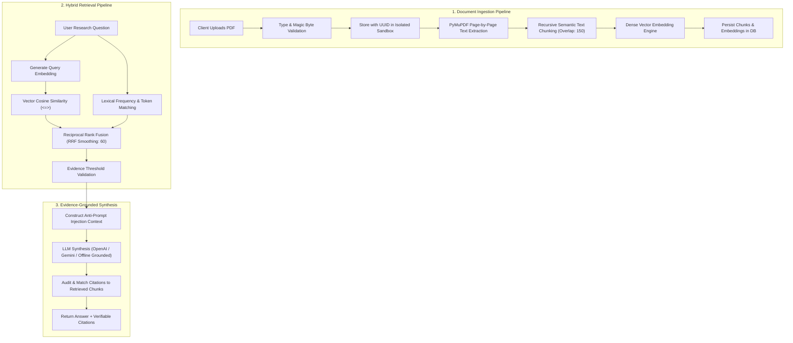

# ResearchPilot AI — Architectural Design Document

## 1. System Overview

**ResearchPilot AI** is an intelligent, evidence-grounded research assistant designed to parse, index, synthesize, and interrogate academic research papers and technical PDF documents.

Unlike conversational LLM wrappers that fabricate assertions or extrapolate beyond their context, ResearchPilot AI implements an auditable Retrieval-Augmented Generation (RAG) architecture where every claim is mapped to verified page-level citations.

---

## 2. End-to-End Pipeline

---

## 3. Key Engineering Components

### 3.1 Document Ingestion & Storage Abstraction
- **Storage Backend (`app.services.storage`)**: Encapsulates file operations behind `StorageBackend`. All user uploads receive server-generated cryptographic UUIDs and are quarantined inside tenant-specific directories, preventing directory traversal (`../`) and filename collision attacks.
- **PyMuPDF (`pymupdf`)**: Extracts text on a page-by-page basis while recording page dimensions and image counts. Automatically detects scanned or image-based PDFs when character density drops below 50 chars/page, raising clear notifications that OCR is required.
- **Recursive Chunking (`app.services.chunker`)**: Segments text by semantic boundaries (paragraphs, sentences, words) while respecting configurable chunk sizes (default 800) and overlap (default 150). Preserves page numbers and estimated token counts for citation mapping.

### 3.2 Hybrid Retrieval with Reciprocal Rank Fusion (RRF)
To prevent the blind spots of dense vector search (such as missing specific mathematical variables or acronyms) and lexical search (missing conceptual paraphrases), ResearchPilot AI executes both retrieval methods simultaneously:

1. **Dense Vector Similarity**: Computes cosine distance between normalized query vectors and document chunk embeddings.
2. **Lexical Token Search**: Evaluates term frequency and query coverage with English stopword filtering.
3. **Reciprocal Rank Fusion (RRF)**: Combines the ranked candidate lists using:
   $$\text{RRF\_Score}(d) = \sum_{m \in \{\text{vector}, \text{keyword}\}} \frac{w_m}{k + \text{rank}_m(d)}$$
   where $k = 60$ and $w_{\text{vector}} = 0.6, w_{\text{keyword}} = 0.4$.

### 3.3 Strict Uncertainty Handling & Anti-Hallucination
When retrieved evidence fails to meet the minimum similarity threshold or when the context does not address the question, the system deliberately refuses to guess. The model issues an explicit uncertainty statement:
> *"Based on the uploaded research documents, there is insufficient evidence to answer this question."*

No deceptive citations or fabricated page numbers are attached to uncertain answers.

### 3.4 Multi-Tenant Authorization
All private entities (`Document`, `DocumentChunk`, `Conversation`, `Message`, `ResearchNote`) are strictly scoped to `user_id`. Database queries enforce user ownership at the ORM layer, preventing cross-tenant data leakage.
